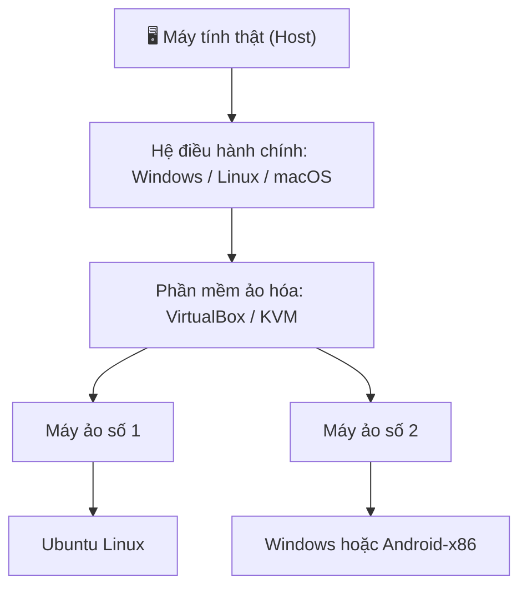

<div align="center">

# 🖥️ CẨM NANG MÁY ẢO
### VirtualBox · Android Virtual Machine · Windows · Linux · Android


**Hướng dẫn tạo, cài đặt, cấu hình và sử dụng máy ảo trên nhiều nền tảng.**

[](https://www.virtualbox.org/)
[](https://www.android.com/)
[](https://www.microsoft.com/windows)
[](https://www.linux.org/)

**Ngôn ngữ:** Tiếng Việt · **Định dạng:** README.md · **Đối tượng:** Người mới bắt đầu

</div>

---

## 📌 Giới thiệu

Tài liệu này hướng dẫn tạo máy ảo trên máy tính và điện thoại. Bạn sẽ học cách chạy một hệ điều hành khác trong một môi trường riêng biệt mà không cần cài đè lên hệ điều hành chính.

### Bạn sẽ học được gì?

- Tạo máy ảo Windows, Ubuntu và Linux bằng **Oracle VirtualBox**.
- Cài đặt VirtualBox trên Windows, Linux và macOS.
- Tạo máy ảo Android trên máy tính bằng **Android Studio Emulator** hoặc **Android-x86**.
- Tạo môi trường Android ảo ngay trên điện thoại Android bằng ứng dụng máy ảo tương thích.
- Dùng **KVM/QEMU** trên Linux.
- Cấu hình RAM, CPU, ổ đĩa, mạng, chia sẻ tệp và xử lý lỗi thường gặp.

> **Phân biệt quan trọng:** GitHub chỉ là nơi lưu trữ và hiển thị tài liệu này. VirtualBox, Android Emulator và các công cụ bên dưới mới là phần mềm tạo/chạy máy ảo.

---

## 🧭 Mục lục

1. [Máy ảo là gì?](#-1-máy-ảo-là-gì)
2. [Chọn công cụ phù hợp](#-2-chọn-công-cụ-phù-hợp)
3. [Chuẩn bị trước khi tạo máy ảo](#-3-chuẩn-bị-trước-khi-tạo-máy-ảo)
4. [Cài VirtualBox trên Windows](#-4-cài-virtualbox-trên-windows)
5. [Tạo máy ảo Windows hoặc Linux bằng VirtualBox](#-5-tạo-máy-ảo-windows-hoặc-linux-bằng-virtualbox)
6. [Cài VirtualBox trên Linux](#-6-cài-virtualbox-trên-linux)
7. [Tạo máy ảo bằng KVM/QEMU trên Linux](#-7-tạo-máy-ảo-bằng-kvmqemu-trên-linux)
8. [Cài VirtualBox trên macOS](#-8-cài-virtualbox-trên-macos)
9. [Tạo máy ảo Android trên Windows/Linux/macOS](#-9-tạo-máy-ảo-android-trên-windowslinuxmacos)
10. [Cài Android-x86 trong VirtualBox](#-10-cài-android-x86-trong-virtualbox)
11. [Tạo Android ảo ngay trên điện thoại Android](#-11-tạo-android-ảo-ngay-trên-điện-thoại-android)
12. [Cấu hình máy ảo hợp lý](#-12-cấu-hình-máy-ảo-hợp-lý)
13. [Chia sẻ tệp, mạng và Snapshot](#-13-chia-sẻ-tệp-mạng-và-snapshot)
14. [Lỗi thường gặp](#-14-lỗi-thường-gặp)
15. [Bảo mật và lưu ý](#-15-bảo-mật-và-lưu-ý)
16. [Liên kết tải và tài liệu chính thức](#-16-liên-kết-tải-và-tài-liệu-chính-thức)

---

## 🧠 1. Máy ảo là gì?

Máy ảo (Virtual Machine — VM) là một máy tính được mô phỏng bằng phần mềm. Máy ảo có CPU, RAM, ổ đĩa và thiết bị mạng ảo riêng, sau đó cài một hệ điều hành vào đó.

Ví dụ:

- Máy thật đang chạy Windows 11.
- Bạn mở VirtualBox.
- Tạo một máy ảo Ubuntu.
- Ubuntu chạy trong cửa sổ riêng, trong khi Windows vẫn hoạt động bình thường.

### Sơ đồ hoạt động



### Một số khái niệm

| Thuật ngữ | Ý nghĩa |
|---|---|
| Host | Máy thật và hệ điều hành chính |
| Guest | Hệ điều hành chạy bên trong máy ảo |
| ISO | Tệp ảnh cài đặt hệ điều hành |
| VDI / VHD / VMDK | Định dạng ổ đĩa máy ảo |
| Snapshot | Điểm lưu trạng thái máy ảo để có thể quay lại |
| Hypervisor | Phần mềm/nền tảng quản lý máy ảo |
| AVD | Thiết bị Android ảo dùng trong Android Emulator |

---

## 🧰 2. Chọn công cụ phù hợp

| Nhu cầu | Công cụ nên tìm hiểu | Nền tảng |
|---|---|---|
| Chạy Windows/Linux trong máy ảo | Oracle VirtualBox | Windows, Linux, macOS |
| Chạy Android ảo để thử ứng dụng | Android Studio Emulator | Windows, Linux, macOS |
| Chạy bản Android dạng hệ điều hành trong VM | Android-x86 + VirtualBox | Máy tính tương thích x86 |
| Tạo VM hiệu năng tốt trên Linux | KVM/QEMU + virt-manager | Linux |
| Tạo không gian Android ảo trên điện thoại | VMOS hoặc ứng dụng tương thích | Android, tùy thiết bị |

<details>
<summary><strong>VirtualBox và Android Emulator khác nhau thế nào?</strong></summary>

- **VirtualBox** là phần mềm ảo hóa đa mục đích, dùng để cài các hệ điều hành như Windows và Linux.
- **Android Emulator** được thiết kế chuyên cho việc mô phỏng thiết bị Android và kiểm thử ứng dụng Android.
- **Android-x86** là dự án chuyển Android sang kiến trúc x86, có thể thử chạy trong máy ảo nhưng khả năng tương thích tùy phiên bản và phần cứng.
- **VMOS** tạo một không gian Android ảo ngay bên trong điện thoại Android. Nó không phải VirtualBox dành cho Android.

</details>

---

## ⚙️ 3. Chuẩn bị trước khi tạo máy ảo

### Kiểm tra cấu hình máy thật

Máy ảo sử dụng tài nguyên của máy thật. Nếu cấp quá nhiều RAM hoặc CPU cho máy ảo, hệ điều hành chính có thể bị chậm.

**Khuyến nghị tham khảo:**

| Tài nguyên máy thật | Mức sử dụng nên cân nhắc |
|---|---|
| RAM 4 GB | Chỉ thử Linux nhẹ; máy ảo cần cấu hình rất thấp |
| RAM 8 GB | Một máy Linux nhẹ hoặc Windows cấu hình vừa phải |
| RAM 16 GB | Có thể chạy một máy ảo phổ thông thoải mái hơn |
| RAM 32 GB trở lên | Phù hợp hơn khi chạy nhiều máy ảo hoặc Android Emulator |
| SSD | Nên dùng để máy ảo khởi động và đọc ghi nhanh hơn |

Đây là mức tham khảo, không phải bảo đảm hiệu năng. Yêu cầu thực tế phụ thuộc hệ điều hành khách, phiên bản công cụ và ứng dụng bạn chạy.

### Bật ảo hóa phần cứng

Máy tính Intel thường có Intel VT-x; máy AMD thường có AMD-V/SVM.

1. Khởi động lại máy tính.
2. Vào BIOS/UEFI (phím thường gặp: F2, Delete, F10 hoặc Esc; tùy hãng).
3. Tìm mục **Intel Virtualization Technology**, **VT-x**, **SVM Mode** hoặc **AMD-V**.
4. Bật tính năng nếu đang tắt.
5. Lưu thay đổi và khởi động lại.

> Không phải máy nào cũng có cùng giao diện BIOS. Nếu không thấy mục này, hãy tra tài liệu của hãng máy hoặc bo mạch chủ.

### Chuẩn bị tệp ISO

Tải ISO từ trang chính thức của hệ điều hành, ví dụ:

- Ubuntu: https://ubuntu.com/download/desktop
- Windows: https://www.microsoft.com/software-download/
- Debian: https://www.debian.org/distrib/
- Fedora: https://fedoraproject.org/workstation/download/
- Android-x86: https://www.android-x86.org/download

Chỉ tải bộ cài từ nguồn đáng tin cậy. Kiểm tra checksum nếu nhà phát hành cung cấp.

---

## 🪟 4. Cài VirtualBox trên Windows


### Bước 1 — Tải VirtualBox

Mở trang tải chính thức:

**https://www.virtualbox.org/wiki/Downloads**

Chọn gói cài đặt dành cho Windows host.

### Bước 2 — Cài đặt

1. Mở tệp cài đặt `.exe`.
2. Chọn **Next**.
3. Giữ các thành phần mặc định nếu bạn chưa có nhu cầu đặc biệt.
4. Chọn **Next** và đồng ý cài các thành phần mạng cần thiết.
5. Nhấn **Install**.
6. Nếu Windows hỏi quyền cài driver, xác nhận khi bạn chắc chắn tệp được tải từ Oracle.
7. Hoàn tất và mở Oracle VM VirtualBox Manager.

<details>
<summary><strong>Ảnh minh họa / trang tải VirtualBox</strong></summary>

Xem giao diện và hướng dẫn cài đặt chính thức tại:
https://docs.oracle.com/en/virtualization/virtualbox/7.2/user/installation.html

</details>

---

## 🐧 5. Tạo máy ảo Windows hoặc Linux bằng VirtualBox

Đây là phần quan trọng nhất. Các bước cơ bản gần giống nhau dù bạn muốn cài Ubuntu, Debian hay Windows.

### Bước 1 — Mở VirtualBox và tạo máy mới

1. Mở **Oracle VM VirtualBox Manager**.
2. Nhấn **New**.
3. Nhập tên máy ảo, ví dụ `Ubuntu-Test`.
4. Chọn thư mục lưu máy ảo.
5. Chọn tệp ISO đã tải.
6. Chọn đúng loại và phiên bản hệ điều hành nếu được yêu cầu.


### Bước 2 — Cấp RAM và CPU

Ví dụ tham khảo cho Ubuntu Desktop:

- RAM: 4 GB nếu máy thật đủ RAM.
- CPU: 2 lõi.
- Không cấp toàn bộ RAM hoặc toàn bộ lõi CPU cho máy ảo.

Ví dụ tham khảo cho Linux nhẹ:

- RAM: 2 GB.
- CPU: 1–2 lõi.

Với Windows 11, hãy kiểm tra yêu cầu hệ thống chính thức và cấu hình TPM 2.0, Secure Boot/UEFI khi cần. Không phải máy ảo nào cũng tự động đáp ứng các yêu cầu đó.

### Bước 3 — Tạo ổ cứng ảo

1. Chọn **Create a Virtual Hard Disk Now**.
2. Chọn định dạng VDI nếu chỉ sử dụng với VirtualBox.
3. Chọn **Dynamically allocated** để tệp ổ đĩa tăng dần theo dữ liệu sử dụng.
4. Chọn dung lượng phù hợp, ví dụ 30–50 GB cho một máy Linux Desktop cơ bản.
5. Xác nhận tạo máy ảo.

<details>
<summary><strong>VDI và Dynamically allocated nghĩa là gì?</strong></summary>

- **VDI:** Định dạng ổ đĩa ảo phổ biến của VirtualBox.
- **Dynamically allocated:** Dung lượng tệp trên máy thật tăng dần khi máy ảo ghi dữ liệu, nhưng vẫn có thể tăng đến giới hạn bạn đã đặt.
- **Fixed size:** Tạo trước tệp ổ đĩa với dung lượng cố định, thường chiếm dung lượng ngay từ đầu.

</details>

### Bước 4 — Khởi động và cài hệ điều hành

1. Chọn máy ảo vừa tạo.
2. Nhấn **Start**.
3. Trình cài đặt từ ISO sẽ xuất hiện.
4. Làm theo hướng dẫn cài đặt của Windows hoặc Linux.
5. Khi cài xong, khởi động lại máy ảo.
6. Tháo ISO khỏi ổ đĩa quang ảo nếu máy vẫn khởi động lại vào trình cài đặt.

### Bước 5 — Cài Guest Additions

Sau khi hệ điều hành khách đã chạy:

1. Chọn menu **Devices** trong cửa sổ máy ảo.
2. Chọn **Insert Guest Additions CD Image**.
3. Mở đĩa ảo bên trong hệ điều hành khách.
4. Chạy trình cài đặt tương ứng.
5. Khởi động lại máy ảo.

Guest Additions có thể cải thiện độ phân giải, clipboard, thư mục chia sẻ và tích hợp chuột. Tính năng hỗ trợ phụ thuộc hệ điều hành khách.

---

## 🐧 6. Cài VirtualBox trên Linux

VirtualBox có gói cài đặt cho nhiều bản phân phối Linux. Hãy chọn đúng gói theo phiên bản Linux và kiến trúc CPU của bạn.

### Cách 1 — Dùng gói từ kho phần mềm của bản phân phối

Trên một số bản Ubuntu/Debian, bạn có thể thử:

```bash
sudo apt update
sudo apt install virtualbox
```

Tên gói và phiên bản có thể khác theo bản phân phối hoặc kho phần mềm đang bật.

### Cách 2 — Dùng gói chính thức của Oracle

1. Mở https://www.virtualbox.org/wiki/Linux_Downloads
2. Chọn đúng bản phân phối và phiên bản.
3. Tải gói cài đặt.
4. Làm theo hướng dẫn Oracle dành riêng cho bản Linux đó.
5. Mở VirtualBox từ menu ứng dụng hoặc Terminal.

**Lưu ý:** Linux có nhiều bản phân phối và phiên bản kernel. Nếu module kernel của VirtualBox không được nạp, hãy đọc thông báo lỗi và hướng dẫn cài module tương ứng; không nên chạy các lệnh không rõ nguồn gốc.

---

## ⚡ 7. Tạo máy ảo bằng KVM/QEMU trên Linux

KVM/QEMU là lựa chọn ảo hóa phổ biến trên Linux. `virt-manager` cung cấp giao diện đồ họa để quản lý máy ảo.


### Bước 1 — Kiểm tra hỗ trợ KVM

Trên Ubuntu, cài công cụ kiểm tra:

```bash
sudo apt update
sudo apt install cpu-checker
kvm-ok
```

Nếu hệ thống báo KVM có thể sử dụng, bạn có thể tiếp tục.

### Bước 2 — Cài QEMU và Virtual Machine Manager

```bash
sudo apt install qemu-system virt-manager
```

### Bước 3 — Mở giao diện quản lý

```bash
virt-manager
```

### Bước 4 — Tạo máy ảo

1. Nhấn biểu tượng tạo máy ảo mới.
2. Chọn cài từ ISO.
3. Chọn tệp ISO Windows/Linux.
4. Chọn RAM và CPU.
5. Tạo ổ đĩa ảo.
6. Xác nhận và khởi chạy trình cài đặt.

Tài liệu Ubuntu chính thức: https://ubuntu.com/server/docs/virtualization-qemu/

---

## 🍎 8. Cài VirtualBox trên macOS

1. Truy cập https://www.virtualbox.org/wiki/Downloads
2. Chọn bộ cài đúng kiến trúc máy Mac: Intel hoặc Apple Silicon.
3. Mở gói `.dmg` và làm theo trình cài đặt.
4. Nếu macOS yêu cầu cấp quyền cho phần mềm hệ thống, hãy làm theo hướng dẫn chính thức của Oracle và macOS.
5. Mở VirtualBox từ thư mục Applications.
6. Tạo máy ảo và chọn hệ điều hành khách tương thích với kiến trúc máy.

**Lưu ý về Apple Silicon:** Máy Mac dùng chip Apple Silicon là ARM64. Máy ảo cần hệ điều hành khách ARM64 tương thích; không nên mặc định rằng ISO x86 của Windows/Linux sẽ chạy như trên máy Mac Intel.

---

## 🤖 9. Tạo máy ảo Android trên Windows/Linux/macOS

Nếu mục tiêu của bạn là mở một chiếc điện thoại Android ảo trên máy tính, lựa chọn chính thức phù hợp để thử nghiệm ứng dụng là **Android Studio Emulator**.


### Bước 1 — Cài Android Studio

Mở trang chính thức:

https://developer.android.com/studio

Tải phiên bản dành cho Windows, Linux hoặc macOS và cài đặt theo hướng dẫn.

### Bước 2 — Mở Device Manager

Có hai cách:

- Tại màn hình Welcome: **More Actions → Virtual Device Manager**.
- Khi đã mở dự án: **View → Tool Windows → Device Manager**.

### Bước 3 — Tạo điện thoại Android ảo

1. Nhấn **Create Device** hoặc nút `+`.
2. Chọn loại thiết bị, ví dụ Phone.
3. Chọn một mẫu điện thoại có sẵn.
4. Chọn phiên bản Android / System Image.
5. Tải System Image nếu được yêu cầu.
6. Chọn cấu hình phù hợp.
7. Nhấn **Finish**.

### Bước 4 — Khởi động Android ảo

1. Trong Device Manager, tìm thiết bị vừa tạo.
2. Nhấn nút **Run** hình tam giác.
3. Chờ Android Emulator khởi động.
4. Màn hình điện thoại Android ảo sẽ xuất hiện.

### Bước 5 — Cài APK để thử nghiệm

Nếu đã có tệp APK hợp lệ, bạn có thể kéo thả APK vào cửa sổ Emulator hoặc dùng ADB:

```bash
adb install ten-ung-dung.apk
```

Để kiểm tra thiết bị đang kết nối:

```bash
adb devices
```

### Cấu hình máy tính tham khảo

Theo tài liệu Android Developers, Android Studio và Emulator cần tài nguyên đáng kể. Mức khuyến nghị cho trải nghiệm tốt là khoảng 16 GB RAM, CPU có hỗ trợ ảo hóa và đủ dung lượng SSD; cấu hình cần thiết có thể cao hơn tùy số lượng thiết bị ảo và phiên bản Android.

Nếu máy yếu, có thể thử trên điện thoại Android thật thay vì chạy Emulator.

Tài liệu chính thức:
- https://developer.android.com/studio/install
- https://developer.android.com/studio/run/managing-avds
- https://developer.android.com/studio/run/emulator

---

## 📱 10. Cài Android-x86 trong VirtualBox

Android-x86 là dự án đưa Android lên nền tảng x86. Có thể thử cài nó trong VirtualBox, nhưng không phải mọi thiết bị ảo, ứng dụng hay phiên bản Android đều tương thích hoàn hảo.

<image src="https://www.android-x86.org/images/android-x86.png" alt="Dự án Android-x86" width="100%">

### Bước 1 — Tải ISO Android-x86

Mở trang dự án:

https://www.android-x86.org/download

Chọn phiên bản phù hợp và tải ISO từ nguồn tải mà dự án cung cấp.

### Bước 2 — Tạo máy ảo mới trong VirtualBox

1. Nhấn **New**.
2. Đặt tên `Android-x86`.
3. Chọn loại Linux/Other Linux 64-bit nếu phù hợp với ISO.
4. Cấp RAM vừa phải, ví dụ 2–4 GB nếu máy thật đủ tài nguyên.
5. Cấp 2 lõi CPU nếu có thể.
6. Tạo ổ đĩa ảo khoảng 16–32 GB để thử nghiệm.
7. Gắn ISO Android-x86 vào ổ đĩa quang ảo.

### Bước 3 — Khởi động ISO

1. Chọn máy ảo.
2. Nhấn **Start**.
3. Chọn chế độ Live nếu chỉ muốn thử trước.
4. Nếu muốn cài lâu dài vào ổ đĩa ảo, chọn mục Installation khi trình khởi động cung cấp.

### Bước 4 — Cài vào ổ đĩa ảo

Làm theo trình cài đặt Android-x86. Các bước phân vùng và bộ nạp khởi động có thể khác theo phiên bản. Hãy đọc hướng dẫn đúng phiên bản trước khi xác nhận ghi dữ liệu.

### Bước 5 — Khởi động Android

Sau khi cài xong:

1. Tắt máy ảo.
2. Tháo ISO khỏi ổ đĩa quang ảo.
3. Khởi động lại máy ảo.
4. Hoàn tất thiết lập Android nếu hệ thống hỗ trợ.

**Ghi chú:** Android-x86 là một phương án thử nghiệm Android trong máy ảo. Nếu mục đích là phát triển và kiểm thử app Android, Android Studio Emulator thường là lựa chọn thuận tiện hơn.

Tài liệu dự án:
- https://www.android-x86.org/
- https://www.android-x86.org/documentation/virtualbox.html

---

## 📲 11. Tạo Android ảo ngay trên điện thoại Android

Nếu bạn muốn tạo một hệ điều hành Android thứ hai bên trong chính chiếc điện thoại đang sử dụng, có thể tìm hiểu ứng dụng **VMOS** từ trang chính thức.

<image src="https://app.vmos.com/vmos/" alt="Trang giới thiệu VMOS — Android ảo trên điện thoại" width="100%">

Trang chính thức: https://app.vmos.com/vmos/

### Cách thiết lập tổng quát

1. Mở trang VMOS chính thức và đọc thông tin tương thích.
2. Chọn liên kết tải phù hợp được cung cấp trên trang chính thức.
3. Cài ứng dụng theo hướng dẫn của nhà phát triển.
4. Mở VMOS và đọc các quyền mà ứng dụng yêu cầu.
5. Chọn môi trường Android ảo nếu ứng dụng cung cấp nhiều lựa chọn.
6. Chờ tải và khởi tạo hệ thống.
7. Mở không gian Android ảo và thiết lập theo hướng dẫn trên màn hình.

### Cần lưu ý trước khi cài

- Máy ảo trên điện thoại dùng chung CPU, RAM, pin và bộ nhớ với Android thật.
- Thiết bị RAM thấp có thể chạy rất chậm, bị đóng ứng dụng nền hoặc không khởi tạo được máy ảo.
- Dung lượng tải về và dung lượng cài đặt thực tế có thể khác nhau.
- Khả năng tương thích phụ thuộc phiên bản Android, kiến trúc CPU và chính sách của nhà sản xuất.
- Không phải ứng dụng nào cũng hoạt động trong môi trường ảo.
- Không cấp quyền nhạy cảm nếu bạn không hiểu vì sao ứng dụng cần quyền đó.

### Có thể dùng VirtualBox trực tiếp trên điện thoại Android không?

**Không có bản VirtualBox chính thức dành cho Android để cài như trên Windows/Linux.** Trên điện thoại, hãy phân biệt ứng dụng tạo không gian Android ảo với phần mềm VirtualBox trên máy tính.

Nếu điện thoại chỉ có RAM 3 GB, việc chạy thêm một hệ điều hành ảo thường không phải lựa chọn phù hợp. Hãy ưu tiên ứng dụng nhẹ hoặc sử dụng máy tính có cấu hình đủ mạnh.

---

## 🎛️ 12. Cấu hình máy ảo hợp lý

### Ví dụ cấu hình tham khảo

| Hệ điều hành khách | RAM gợi ý | CPU gợi ý | Ổ đĩa ảo gợi ý |
|---|---:|---:|---:|
| Ubuntu Desktop | 4 GB | 2 lõi | 30–40 GB |
| Linux nhẹ | 2 GB | 1–2 lõi | 16–25 GB |
| Windows 10 | 4–8 GB | 2–4 lõi | 50–64 GB |
| Windows 11 | Theo yêu cầu chính thức | Theo yêu cầu chính thức | Theo yêu cầu chính thức |
| Android-x86 thử nghiệm | 2–4 GB | 2 lõi | 16–32 GB |
| Android Emulator | Theo tài liệu Android Studio | CPU hỗ trợ ảo hóa | Dành đủ dung lượng cho SDK và AVD |

Các con số là gợi ý khởi đầu, không phải yêu cầu tối thiểu hay bảo đảm chạy mượt.

### Mẹo tăng hiệu năng

- Lưu máy ảo trên SSD.
- Không chạy nhiều VM cùng lúc nếu RAM hạn chế.
- Tắt ứng dụng nặng trên máy thật.
- Không cấp toàn bộ RAM hoặc CPU cho VM.
- Dùng Guest Additions hoặc công cụ tích hợp tương ứng.
- Giữ đủ dung lượng trống cho hệ điều hành chính.

---

## 🔗 13. Chia sẻ tệp, mạng và Snapshot

### Chia sẻ thư mục giữa máy thật và máy ảo

Trong VirtualBox:

1. Chọn máy ảo và mở **Settings**.
2. Chọn **Shared Folders**.
3. Nhấn biểu tượng thêm thư mục.
4. Chọn thư mục trên máy thật.
5. Bật Auto-mount nếu cần.
6. Khởi động máy ảo và truy cập thư mục được chia sẻ.

Một số hệ điều hành khách cần cài Guest Additions và cấp quyền người dùng phù hợp.

### Chế độ mạng cơ bản

| Chế độ | Công dụng |
|---|---|
| NAT | Máy ảo truy cập Internet thông qua máy thật |
| Bridged Adapter | Máy ảo xuất hiện như thiết bị riêng trên mạng LAN |
| Host-only Adapter | Giao tiếp riêng giữa máy thật và máy ảo |
| Internal Network | Kết nối các máy ảo trong mạng nội bộ ảo |

### Snapshot là gì?

Snapshot lưu trạng thái máy ảo tại một thời điểm để bạn có thể quay lại khi thử nghiệm gặp lỗi.

Ví dụ:

1. Cài Ubuntu xong.
2. Cập nhật hệ thống.
3. Tạo snapshot `Ubuntu-clean`.
4. Thử cài phần mềm.
5. Nếu gặp lỗi, có thể khôi phục snapshot.

Snapshot không thay thế bản sao lưu. Hãy sao lưu các tệp quan trọng ra nơi khác.

---

## 🧯 14. Lỗi thường gặp

### Lỗi: VT-x/AMD-V không khả dụng

- Kiểm tra BIOS/UEFI đã bật ảo hóa chưa.
- Kiểm tra máy tính có hỗ trợ ảo hóa không.
- Kiểm tra xung đột với nền tảng ảo hóa khác.
- Đọc tài liệu VirtualBox dành cho hệ điều hành host của bạn.

### Lỗi: Máy ảo chạy rất chậm

- Giảm số máy ảo đang chạy cùng lúc.
- Kiểm tra RAM máy thật.
- Dùng SSD nếu có.
- Kiểm tra cấu hình CPU/RAM của VM.
- Chọn bản hệ điều hành khách nhẹ hơn.

### Lỗi: Không khởi động được ISO

- Kiểm tra tệp ISO tải về có đầy đủ không.
- Kiểm tra kiến trúc ISO có tương thích với CPU máy thật không.
- Kiểm tra thứ tự khởi động.
- Kiểm tra thiết lập EFI/BIOS của máy ảo.

### Lỗi: Android Emulator không chạy

- Kiểm tra yêu cầu hệ thống Android Studio.
- Kiểm tra hỗ trợ ảo hóa và tăng tốc phần cứng.
- Cập nhật Android Studio và Emulator.
- Thử tạo AVD có cấu hình nhẹ hơn.
- Nếu máy tính không đủ tài nguyên, thử trên thiết bị Android thật.

### Lỗi: Điện thoại không chạy được Android ảo

- Kiểm tra phiên bản Android và kiến trúc CPU mà ứng dụng hỗ trợ.
- Kiểm tra dung lượng trống.
- Đóng các ứng dụng nền không cần thiết.
- Không cố chạy nếu thiết bị quá nóng hoặc liên tục bị treo.
- Gỡ ứng dụng nếu nó không tương thích hoặc yêu cầu quyền không hợp lý.

---

## 🔐 15. Bảo mật và lưu ý

- Chỉ tải ISO và phần mềm từ website chính thức hoặc nguồn được dự án xác nhận.
- Không chạy tệp lạ trong máy thật chỉ vì nó được giới thiệu là “máy ảo có sẵn”.
- Không chia sẻ thư mục chứa mật khẩu, dữ liệu cá nhân hoặc khóa API với máy ảo không đáng tin cậy.
- Dùng Snapshot trước các thử nghiệm có rủi ro làm hỏng hệ điều hành khách.
- Không dùng máy ảo để né các biện pháp bảo vệ, điều khoản dịch vụ hoặc giới hạn truy cập.
- Kiểm tra giấy phép của hệ điều hành và phần mềm trước khi sử dụng.

---

## 🔗 16. Liên kết tải và tài liệu chính thức

### VirtualBox

- [Trang chủ VirtualBox](https://www.virtualbox.org/)
- [Tải VirtualBox](https://www.virtualbox.org/wiki/Downloads)
- [Tài liệu người dùng VirtualBox](https://www.virtualbox.org/manual/)
- [Hướng dẫn cài đặt VirtualBox](https://docs.oracle.com/en/virtualization/virtualbox/7.2/user/installation.html)

### Android

- [Android Studio](https://developer.android.com/studio)
- [Cài Android Studio](https://developer.android.com/studio/install)
- [Tạo Android Virtual Device](https://developer.android.com/studio/run/managing-avds)
- [Chạy Android Emulator](https://developer.android.com/studio/run/emulator)
- [Android-x86](https://www.android-x86.org/)
- [VMOS](https://app.vmos.com/vmos/)

### Linux

- [Ubuntu Desktop](https://ubuntu.com/download/desktop)
- [Ubuntu Server — QEMU](https://ubuntu.com/server/docs/virtualization-qemu/)
- [Ubuntu — Virtual Machine Manager](https://ubuntu.com/server/docs/how-to/virtualisation/virtual-machine-manager/)
- [QEMU](https://www.qemu.org/)

---

<div align="center">

## 🌌 CHÚC BẠN TẠO MÁY ẢO THÀNH CÔNG!

**Tìm hiểu · Thử nghiệm · Học tập · Phát triển**

<sub>Tài liệu cộng đồng bằng tiếng Việt. Giao diện phần mềm có thể thay đổi theo phiên bản.</sub>

[](https://github.com/)

</div>
